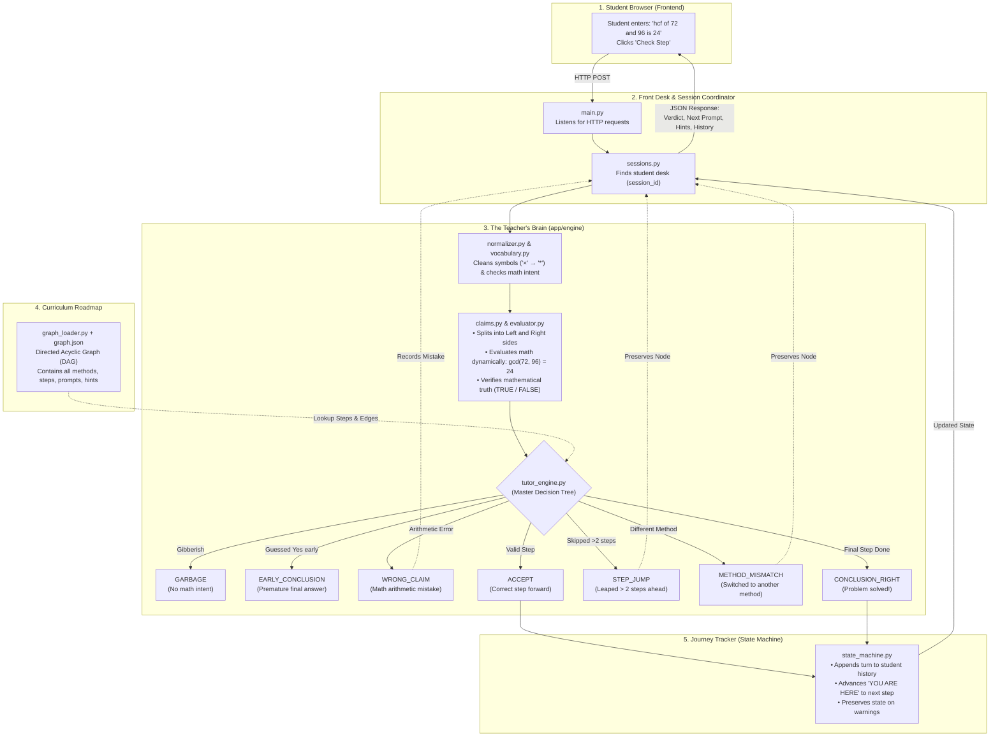
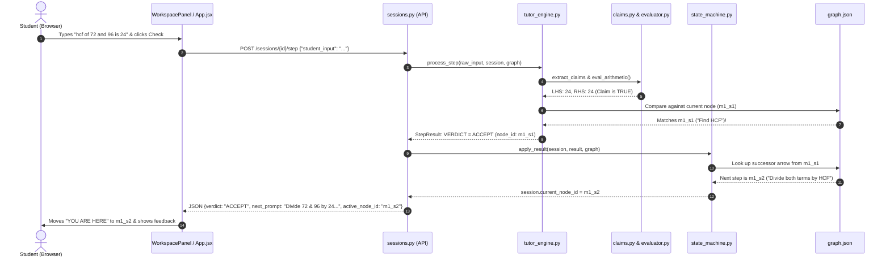

# Ainstein Math Backend: Complete Pipeline & Architecture Guide

> **Audience**: Written for anyone wanting a comprehensive, beginner-friendly understanding of how the Ainstein Math Socratic backend works, without requiring a computer science or software engineering background.

---

## 1. The Core Idea: An AI Socratic Math Tutor

Instead of acting like a generic AI chatbot (which guesses words and can hallucinate), the Ainstein Math backend functions like an **expert human math teacher sitting next to a student**:

1. **It reads and cleans up student writing**: Standardizes math symbols ($\times, \div, *$, /) and messy phrasing.
2. **It computes actual math**: It does not guess answers; it has a built-in arithmetic calculator that evaluates expressions like $\gcd(72, 96) = 24$ or $3 \times 96 = 288$.
3. **It navigates a Solution Graph**: Every problem has a curriculum roadmap (a "subway map" of all valid solving methods and steps).
4. **It enforces Socratic pedagogy**: It detects whether the student made a genuine step forward, committed an arithmetic error, leaped too far ahead without showing intermediate work, or jumped into a completely different solution method.

---

## 2. High-Level Architecture Diagram



---

## 3. The 3 Main Divisions of the Backend

```
backend/
├── app/
│   ├── main.py              ← The Front Door
│   ├── graph_loader.py      ← The Curriculum Librarian
│   ├── api/v1/              ← The Front Desk / Office
│   ├── engine/              ← The Teacher's Brain
│   ├── schemas/             ← The Blueprint Forms
│   └── services/            ← The Student Diary / Logger
```

### Division 1: Front Desk & Reception (`main.py`, `sessions.py`, `problems.py`)
- **`main.py`**: The server's entry point. It wakes up the application, initializes the textbook cache, enables secure connections, and routes web traffic.
- **`sessions.py`**: Manages the student's active tutoring desk (`session_id`). When an answer arrives, it looks up the student's current position, sends the answer to the grading engine, receives the verdict, and formats the reply note back to the browser.
- **`problems.py`**: The menu catalog. It supplies the list of available textbook problems to the browser.

### Division 2: The Curriculum Library (`graph_loader.py`, `graph.json`)
- **`graph.json`**: A blueprint of the problem (known mathematically as a DAG: Directed Acyclic Graph). It maps out:
  - Every valid method (e.g. Method 1: HCF Simplification, Method 5: Cross Multiplication).
  - Every sequential step in each method.
  - The prompts, hints, and acceptable answers for each step.
- **`graph_loader.py`**: Reads all `graph.json` files on server startup and keeps them in memory for fast access.

### Division 3: The Teacher's Brain (`backend/app/engine/`)
This is the core intelligence of the tutor:

1. **`normalizer.py`**: The "eraser and cleaner". Cleans student handwriting, translates symbols (`×` $\to$ `*`, `÷` $\to$ `/`, `is` $\to$ `=`), and removes distracting spaces.
2. **`vocabulary.py`**: The "math dictionary". Checks if words in the student's sentence carry mathematical intent (`"divide"`, `"hcf"`, `"cross"`, `"fraction"`).
3. **`evaluator.py`**: The "math calculator". Performs true arithmetic using Python's mathematical engine. Evaluates calculations like $3 \times 96 = 288$ and functions like $\gcd(72, 96) = 24$.
4. **`claims.py`**: The "truth inspector". Breaks sentences into Left-Hand Side (LHS) and Right-Hand Side (RHS), computes each side with `evaluator.py`, and decides if the equality claim is **TRUE** or **FALSE**.
5. **`matcher.py`**: The "answer-key matcher". Checks if the student's input directly matches pre-approved phrases in the curriculum.
6. **`tutor_engine.py`**: The "head teacher". Evaluates the step against pedagogical rules in strict order of priority.
7. **`state_machine.py`**: The "GPS navigator". Moves the student from step to step along the solution graph and maintains their historical path (`trail`).

---

## 4. Life of a Step: Sequence of Events

Here is the exact sequence of events when a student submits an answer:



---

## 5. Master Decision Tree: How the Tutor Chooses a Verdict

When an answer arrives at `tutor_engine.py`, it is evaluated through a **hierarchical decision tree**:

| Priority | Check Name | Condition | Verdict | Feedback to Student |
| :---: | :--- | :--- | :--- | :--- |
| **1** | **Garbage Guard** | No math words, numbers, or symbols found. | `GARBAGE` | *"That does not look related to this problem. Try writing a calculation."* |
| **2** | **Early Conclusion Guard** | Student typed "yes" or "proportional", but has not demonstrated their working steps yet. | `EARLY_CONCLUSION` | *"That's correct! But before we conclude, please show your work step-by-step."* |
| **3** | **Truth & Mistake Checker** | Student wrote an equation where LHS $\neq$ RHS (e.g. `hcf is 23` when $\gcd=24$, or $3 \times 96 = 287$). | `WRONG_CLAIM` | *"🔴 hcf(72, 96) is 24 and 23 is 23 - so this doesn't hold. Fix this calculation."* |
| **4** | **Current Step Match** | Matches the node currently awaited (Pass 1: exact text; Pass 2: mathematical value). | `ACCEPT` | *"That's correct. What's your next step?"* |
| **5** | **Reversed Ratio Guard** | Student wrote inverted terms (e.g. $4:3$ instead of $3:4$). | `REVERSED_RATIO` | *"Check the order of your terms. Keep numerator and denominator aligned."* |
| **6** | **Irrelevant True Math** | Mathematically true, but unrelated to problem numbers (e.g. $2 + 2 = 4$). | `IRRELEVANT_TRUE` | *"That is true, but it doesn't help with these quantities."* |
| **7** | **Bounded Step Hop (≤ 2 hops)** | Student skipped ahead 1 or 2 steps along the current method chain. | `ACCEPT` | Accepted! The state machine fast-forwards to that step. |
| **8** | **Step Jump (> 2 hops)** | Student jumped > 2 steps ahead without showing intermediate reasoning. | `STEP_JUMP` | *"That calculation is part of that method, but you leaped ahead without showing intermediate work."* |
| **9** | **Method Mismatch** | Student is in Method 1 (Simplification), but entered a valid step of Method 5 (Cross-Multiplication). | `METHOD_MISMATCH` | *"That calculation belongs to Cross Multiplication, but you are using Simplification. Stick with your method or reset."* |
| **10** | **Conclusion Match** | Student reached the final node and gives the valid answer. | `CONCLUSION_RIGHT` | *"🏆 Problem solved! Both ratios are proportional."* |

---

## 6. How State Persistence Works (No Lost Work)

Whenever an unexpected input occurs (like a `STEP_JUMP`, `METHOD_MISMATCH`, or `EARLY_CONCLUSION`):
- **The session pointer is NOT broken**: The student's `"YOU ARE HERE"` marker remains securely at their last completed step.
- **The turn history is preserved**: The student receives an explanatory message, their input is cleared, and they can continue immediately without starting over.
- **Only true verified steps** are appended to `session.trail`, ensuring the graph visualizer and progress indicators remain clean and accurate.

---

## 7. Summary Table of All Backend Files

| File Path | Functional Role | Analogy in School |
| :--- | :--- | :--- |
| `app/main.py` | FastAPI application configuration, CORS, and server startup. | The school building front door. |
| `app/graph_loader.py` | Loads and indexes `graph.json` DAGs into an in-memory dictionary. | The curriculum library and textbook archive. |
| `app/api/v1/sessions.py` | Handles `POST /start`, `POST /step`, `POST /reset`, and session logging. | The session coordinator desk assigning desks to students. |
| `app/api/v1/problems.py` | Lists available chapters, topics, and problem IDs. | The school course catalog. |
| `app/engine/normalizer.py` | Cleans spacing, standardizes arithmetic symbols, formats numbers. | The handwriting eraser and cleanup assistant. |
| `app/engine/vocabulary.py` | Identifies mathematical intentions and filters out conversational noise. | The math dictionary. |
| `app/engine/evaluator.py` | Evaluates arithmetic AST, GCD, LCM, square roots, and basic powers. | The verified scientific calculator. |
| `app/engine/claims.py` | Extracts equalities and ratio proportions; verifies true/false status. | The fact checker verifying mathematical truth. |
| `app/engine/matcher.py` | Compares student text to known acceptable graph phrases. | The official answer key. |
| `app/engine/tutor_engine.py` | Implements the 10-tier master decision tree for grading student steps. | The head teacher deciding pedagogical feedback. |
| `app/engine/state_machine.py` | Maintains `session.trail`, advances `current_node_id`, locks methods. | The subway navigator tracking the student's progress. |
| `app/services/session_logger.py` | Records every turn, verdict, and timestamp into structured JSON logs. | The student diary preserving records for review. |

