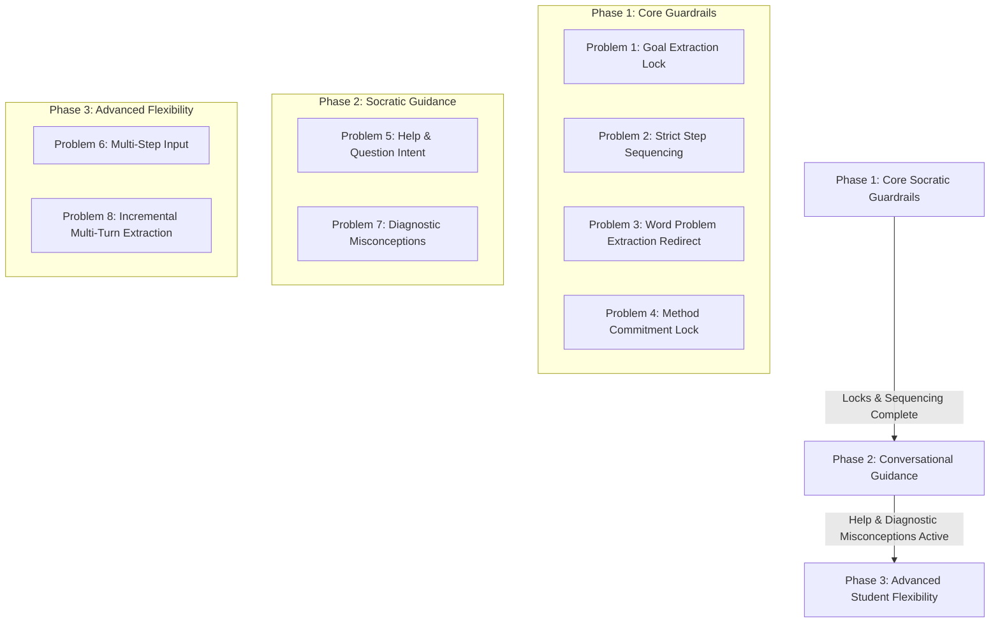

# Socratic Math Tutor: Pedagogical Problems, Solutions & Implementation Blueprint

This document specifies the key pedagogical challenges identified in the Socratic Math Tutor, their root causes, technical solutions, exact Before vs. After tutor dialogue behaviors, and the complete codebase implementation blueprint.

---

# Part 1: Core Socratic Flow & State Machine Guardrails

---

### Problem 1: Universal Conclusion Leak & Phase Boundary Breakdown (Systemic Across All 32 Problems)
* **The Systemic Flaw Across All 32 Problems:**  
  This is **not** an isolated quirk of Problem 1 (`g08-hegp107-ex001`). An automated audit across all 32 problem graphs reveals that almost every problem has short words or single numbers in its conclusion node's `accept` list:
  * **Chapter 7 Ratio Problems** (`ex001`, `ex002-ratio`, `ex004`): Conclusion accepts `["proportional", "yes", "yes proportional"]`. When a student in extraction or Step 1 types *"whether they are proportional or not"*, the engine matches the substring `"proportional"` and prematurely terminates the problem!
  * **Chapter 11 Age Word Problem** (`g08-hegp206-age-q7`): Conclusion accepts `["6", "6 years"]`. If a student in given extraction writes *"Difference between ages is 6 years"*, the conclusion fires immediately!
  * **Chapter 8 Inverse Proportion** (`ex003`, `ex005`, `ex006`): Conclusion accepts single numbers like `["8"]`, `["12"]`, `["36"]`. If a student mentions *"8 workers"* in extraction, the engine declares the entire problem solved!
  * **Chapters 1 & 2 Powers/Roots** (`sqrt-324`, `cbrt-3375`, `p11-q1`): Conclusion accepts `["18"]`, `["15"]`, `["8"]`.
  
  **Root Cause in Engine Architecture:**  
  1. `tutor_engine.py` calls `detect_conclusion()` at the top of `process_step` on *every turn*, even when the student is in Pólya extraction or Step 1 of a 4-step calculation!
  2. `matcher.py` performs loose single-word substring matching (`if normalized_accepted in normalized_input:`). Any sentence containing that word/number triggers an accidental match.

* **Why a Problem-Specific Fix is an Anti-Pattern:**  
  Adding `"proportional or not"` to `g08-hegp107-ex001/graph.json` is a brittle "whack-a-mole" hack. It leaves the other 31 problems completely exposed to the same premature conclusion leaks.

* **The Generalized, Systemic Solution (Engine-Level Guardrails for All 32 Problems):**  
  1. **Phase Lockdown (Extraction Gate):**  
     In `tutor_engine.py`, completely disable `detect_conclusion()` whenever `session.current_node_id` is an extraction node (`given_extraction` or `goal_extraction`). During the extraction phase, the student is defining the problem, not answering it.
  2. **Prerequisite DAG Completion Gate (No Premature Conclusion):**  
     A conclusion match can **only** be accepted if the DAG traversal has legitimately reached `graph.conclusion_node`, OR if all prerequisite calculation steps in the active method chain have been validated in `session.trail`.
  3. **Strict Matching on Conclusion Nodes:**  
     For conclusion nodes, disable loose substring inclusion in `matcher.py`. A conclusion answer must match exactly (`normalized_input == normalized_accepted`) or as a dedicated conclusion assertion, preventing casual mentions of numbers or words from triggering it.
  4. **Semantic Goal Extraction:**  
     Recognize question-seeking intent during `goal_extraction` across all problems so that phrases like *"find whether proportional"*, *"what is the age"*, or *"calculate the speed"* are naturally accepted without needing brittle per-problem dictionaries.

* **How the Tutor will behave across all 32 problems:**
  * **Student types in extraction:** `proportional or not` (or `find if proportional`, or `age after 6 years`)
  * **Tutor response:**  
    ✅ *"That's correct! We need to determine if the two ratios are proportional. Now, choose a method to solve it: you can simplify using HCF, cross-multiply, or scale."*
  * **Session state:** Securely advances to **Method Selection / Step 1**. The conclusion is completely locked until all mathematical steps are performed.

---

### Problem 2: Skipping Intermediate Steps Mid-Method (Leapfrogging to the End)
* **What happens right now:**  
  Once a student completes Step 1 of a method (e.g., finding HCF = 24), they immediately type the final step of that method (e.g., `3:4 = 3:4` or `they are proportional`). The engine's global search accepts it and marks the problem solved, allowing the student to bypass dividing $72/24$ and $96/24$.
* **The Solution & Reasoning:**  
  **Strict Sequential DAG Traversal:**  
  A student can only advance the node that is currently active (`session.current_node_id`). The conclusion node is locked until all prerequisite intermediate step nodes in that method's chain have been recorded in `session.trail`.
* **How the Tutor will behave:**
  * **Active Step:** Step 2 (*"Now divide 72 and 96 by 24"*).
  * **Student tries to skip:** `They are proportional!`
  * **Tutor response:**  
    ⏸️ *"You're getting ahead of yourself! Before we compare or conclude, please show the calculation: divide both 72 and 96 by 24 first."*
  * **Session state:** Stays at **Step 2** until the calculation is entered.

---

### Problem 3: Jumping Directly to Calculation on Word Problems (Skipping Extraction)
* **What happens right now:**  
  In word problems (e.g. Scooter Depreciation), Pólya extraction is required (`optional: false`). A student calculates the depreciation right away: `1050` (or `5% of 21000 = 1050`). The tutor rejects it with an error: *"1050 does not help answer this question"*, frustrating the student because their math was actually correct.
* **The Solution & Reasoning:**  
  **"Acknowledge & Redirect" Interceptor:**  
  If the student's math matches a valid future step in the solution graph, but the session is still on a required extraction node, the tutor does **not** call it wrong. It praises the math but firmly redirects them to identify the givens first.
* **How the Tutor will behave:**
  * **Active Step:** Given Extraction (*"Identify the purchase price, rate, and time"*).
  * **Student types:** `5% of 21000 = 1050`
  * **Tutor response:**  
    💡 *"Great calculation! 1050 is indeed the depreciation amount, and we will use that in just a moment. But for word problems, let's first list what is given: What are the original value, the depreciation rate, and the time period?"*
  * **Session state:** Student feels validated and willingly completes the extraction.

---

### Problem 4: Enforcing Method Commitment (No Mid-Way Switching)
* **What happens right now / Decision:**  
  Once a method is chosen, the student must commit to seeing that method through to completion rather than jumping between methods mid-way.
* **The Solution & Reasoning:**  
  Once `session.method_id` is set (e.g. `m1_simplify`), the tutor strictly filters all step searches to `m1_*`. If the student suddenly gives a step from Method 5 (Cross Multiplication: `3 * 96 = 288`), the engine rejects it as irrelevant to the current train of thought.
* **How the Tutor will behave:**
  * **Student is on Method 1 (HCF) and types:** `3 * 96 = 288`
  * **Tutor response:**  
    ⚠️ *"3 * 96 = 288 is true, but you are currently using the HCF Simplification method. Let's finish this method first: divide 72 and 96 by your HCF (24)."*

---

# Part 2: Complementary Pedagogical Enhancements

---

### Problem 5: The "I'm Stuck / Help" Request
* **What happens right now:**  
  A student types: *"I don't know"*, *"How do I find HCF?"*, *"Give me a hint"*, or *"What is depreciation?"*.  
  The engine tries to parse it as math, fails, and gives a harsh error:  
  ❌ `GARBAGE`: *"That does not look related to this problem."*
* **The Solution & Reasoning:**  
  **Help & Question Intent Classifier:**  
  Add an intent filter for phrases like `"help"`, `"don't know"`, `"what is"`, `"hint"`, or sentences ending with `?`. When detected, route directly to the active node's hint or pedagogical explanation instead of marking it garbage.
* **How the Tutor will behave:**
  * **Student types:** `how do I find the HCF of 72 and 96?`
  * **Tutor response:**  
    🤝 *"No problem! To find the HCF, look for the largest number that divides both 72 and 96 without a remainder. (Hint: Both numbers are divisible by 12 and 24. Try testing 24!)"*

---

### Problem 6: The "Fast Learner" Multi-Step Input
* **What happens right now:**  
  A student writes both Step 1 and Step 2 in one turn:  
  `5% of 21000 = 1050, so 21000 - 1050 = 19950`.  
  The tutor only looks for `1050`. The extra text causes the step to fail or only credits Step 1, ignoring the subtraction they already completed.
* **The Solution & Reasoning:**  
  **Compound Claim Evaluation:**  
  Allow the parser to extract multiple mathematical claims from a single turn. If claims satisfy Step 1 **and** the successor Step 2, the engine advances the DAG through both steps simultaneously in that single turn.
* **How the Tutor will behave:**
  * **Student types:** `5% of 21000 = 1050, then 21000 - 1050 = 19950`
  * **Tutor response:**  
    🌟 *"Excellent work! You calculated the depreciation (1050) and subtracted it (19950) all in one step. Now, state your final conclusion for the scooter's value."*
  * **Session state:** Advances directly to **Conclusion**; records both steps in the history.

---

### Problem 7: Conceptual Misconceptions vs. Raw Arithmetic Errors
* **What happens right now:**  
  A student adds depreciation instead of subtracting: `21000 + 1050 = 22050`.  
  The tutor responds with dry arithmetic logic:  
  🔴 *"21000+1050 is 22050 and 19950 is 19950 - so '21000+1050 = 19950' doesn't hold."*  
  It doesn't tell the student *why* adding was conceptually wrong.
* **The Solution & Reasoning:**  
  **Diagnostic Misconception Catalog:**  
  Recognize common cognitive traps (e.g. adding for depreciation, multiplying across rows instead of cross-multiplying). When detected, return a conceptual explanation rather than a raw equation mismatch.
* **How the Tutor will behave:**
  * **Student types:** `21000 + 1050 = 22050`
  * **Tutor response:**  
    💡 *"Be careful! Depreciation means the asset **loses** value over time. You added 1050, but we need to **subtract** the depreciation from the original price."*

---

### Problem 8: Partial / Incremental Extraction Across Multiple Turns
* **What happens right now:**  
  In word problems with 3 givens (Price, Rate, Time), if a student writes just one:  
  `Original value is ₹21,000`  
  The node rejects it because it expects all three in that single response.
* **The Solution & Reasoning:**  
  **Incremental Entity Extraction:**  
  Store an `extracted_entities` set in the session. As the student mentions Price, Rate, or Time, tick them off individually until all three are satisfied.
* **How the Tutor will behave:**
  * **Turn 1 Student:** `Original price is 21000`
  * **Tutor response:** ✅ *"Got the original price (₹21,000)! What are the depreciation rate and time period?"*
  * **Turn 2 Student:** `5% for 1 year`
  * **Tutor response:** ✅ *"Perfect, all given information identified! What do we need to calculate?"*

---

# Part 3: Technical Architecture & Codebase Implementation Blueprint

Below is the mapping of which files in `backend/app/engine/` implement each solution, along with the exact algorithmic design:

```
backend/app/engine/
├── tutor_engine.py    <-- Guardrails, step sequencing, help routing, extraction redirect
├── state_machine.py   <-- Method chain verification, conclusion locking, session tracking
├── claims.py          <-- Misconception diagnosis & compound claim extraction
├── matcher.py         <-- Extraction string matching & substring guard
└── vocabulary.py      <-- Intent keywords for "help" and question detection
```

---

### Implementation Details by Problem

#### 1. Code Changes for Problem 1 (Universal Conclusion Guardrails Across All 32 Problems)
* **File:** `backend/app/engine/tutor_engine.py` (inside `detect_conclusion` and `process_step`)
```python
def detect_conclusion(parsed: ParsedStep, session: Session, graph: SolutionGraph, ctx: Dict[str, Tuple[float, float]]) -> Optional[Dict[str, Any]]:
    # GUARD 1: Completely disable conclusion matching during extraction phase
    # (Protects all 32 problems from extraction input colliding with conclusion keywords)
    if session.current_node_id in ("given_extraction", "goal_extraction"):
        return None

    # GUARD 2: Conclusion only allowed when on conclusion node or when all method steps are satisfied
    if session.current_node_id != graph.conclusion_node:
        if not session.method_id or not has_completed_method_chain(session, graph):
            return None
    ...
```
* **File:** `backend/app/engine/matcher.py` (strict matching for conclusion nodes)
```python
# Guard against loose single-word substring matches when evaluating conclusion answers
def matches_conclusion_node(raw_input: str, accepts: List[str]) -> bool:
    norm_in = normalize_text(raw_input)
    for a in accepts:
        norm_acc = normalize_text(a)
        # Require exact match or full word match, not substring inclusion
        if norm_in == norm_acc:
            return True
        # Reject question/condition words ("if", "whether", "or not") from qualifying as conclusion claims
        if any(q in norm_in for q in ["whether", "or not", "if", "is it", "are they", "to find"]):
            return False
    return False
```
*(No per-problem JSON edits required; this protects all 32 problem graphs universally at the engine level).*

#### 2. Code Changes for Problem 2 (Strict Step Sequencing / No Skip-Ahead)
* **File:** `backend/app/engine/tutor_engine.py` (inside `find_global_step_match`)
```python
def find_global_step_match(parsed: ParsedStep, session: Session, graph: SolutionGraph) -> Optional[Dict[str, Any]]:
    # If method is active, inspect if the match is a future step that skips current step
    if session.method_id and session.current_node_id:
        chain = method_chain(session.method_id, graph)
        cur_idx = chain.index(session.current_node_id) if session.current_node_id in chain else -1
        
        for node in ordered:
            if matches_node_exact_or_semantic(parsed, node):
                node_idx = chain.index(node.id) if node.id in chain else -1
                if node_idx > cur_idx:
                    # Return SKIPPED_STEP indicator so tutor holds the student back
                    return {"skipped_ahead": True, "target_node": node, "current_node": session.current_node_id}
                return {"node_id": node.id, "method_id": method_of(node.id)}
```

#### 3. Code Changes for Problem 3 (Acknowledge & Redirect on Word Problems)
* **File:** `backend/app/engine/tutor_engine.py` (in `process_step`)
```python
# Before falling back to IRRELEVANT_TRUE during required extraction:
if session.current_node_id in ("given_extraction", "goal_extraction"):
    if not has_completed_required_extraction(session, graph):
        # Check if the student's arithmetic matches any step in any method
        future_match = check_against_all_method_steps(parsed, graph)
        if future_match:
            return StepResult(
                verdict="EXTRACTION_REQUIRED",
                parsed=parsed,
                node_id=session.current_node_id,
                feedback=f"Great calculation! That will come in handy shortly. But for this word problem, let's first list what is given: {cur_node.prompt}"
            )
```

#### 4. Code Changes for Problem 4 (Method Commitment)
* **File:** `backend/app/engine/tutor_engine.py`
```python
# When method is active and input matches another method's step:
if session.method_id and other_method_match:
    return StepResult(
        verdict="METHOD_LOCKED",
        parsed=parsed,
        node_id=session.current_node_id,
        feedback=f"That calculation belongs to {other_method.label}, but you are currently solving with {cur_method.label}. Let's stick with this method: {cur_node.prompt}"
    )
```

#### 5. Code Changes for Problem 5 (Help / Question Intent Detection)
* **File:** `backend/app/engine/vocabulary.py`
```python
HELP_INTENT_PATTERNS = [
    r"\bhelp\b", r"\bhint\b", r"\bdon'?t know\b", r"\bnot sure\b",
    r"\bconfused\b", r"\bhow (do|can) I\b", r"\bwhat is\b", r"\bstuck\b", r"\?$"
]
```
* **File:** `backend/app/engine/tutor_engine.py`
```python
if is_help_intent(parsed.raw):
    hint = hint_for(session, graph, session.current_node_id)
    return StepResult(
        verdict="HELP_REQUESTED",
        parsed=parsed,
        node_id=session.current_node_id,
        feedback=f"No problem, let's work through this step together! {hint or cur_node.description}"
    )
```

#### 6. Code Changes for Problem 6 (Compound Multi-Step Evaluation)
* **File:** `backend/app/engine/tutor_engine.py`
- Parse multi-expression statements joined by `then`, `so`, or commas.
- If expression 1 matches `current_node_id` and expression 2 matches `successor_of(current_node_id)`:
  - Advance the DAG by 2 nodes in a single turn.
  - Return `MULTI_STEP_ACCEPT`.

#### 7. Code Changes for Problem 7 (Diagnostic Misconceptions)
* **File:** `backend/app/engine/claims.py`
- Detect known arithmetic operation flips:
  - `depreciation_add`: When `price + depreciation_amount` is calculated instead of subtraction.
  - `percentage_multiply_only`: When `price * rate` is calculated without dividing by 100.
  - Deliver diagnostic feedback explaining *why* the mathematical concept requires the opposite operation.

#### 8. Code Changes for Problem 8 (Incremental Entity Extraction)
* **File:** `backend/app/engine/state_machine.py`
- Add `extracted_entities: Set[str] = field(default_factory=set)` to `Session`.
- In `given_extraction`, record each identified quantity (Value, Rate, Time).
- Only advance when all required quantities for the problem have been identified.

---

# Part 4: Three-Phase Implementation Roadmap



---

### Summary Matrix

| Capability | Current Tutor Behavior | With These Solutions | Target Code File |
| :--- | :--- | :--- | :--- |
| **Conclusion Safety** | Vulnerable to early guesses (`"proportional"`) | 🛡️ **Guarded:** Unlocks only after all calculations are proven | `tutor_engine.py` |
| **Step Discipline** | Allows skipping intermediate math | 📏 **Sequential:** Enforces step-by-step reasoning | `tutor_engine.py` |
| **Word Problem Math** | Punishes students who calculate directly | 🤝 **Praising:** Acknowledges math, redirects to givens | `tutor_engine.py` |
| **Method Switching** | Fragmented jumping allowed | 🔒 **Committed:** Keeps student on their chosen path | `tutor_engine.py` |
| **Help Requests** | Marked as `GARBAGE` | 💡 **Empathetic:** Provides hints & explanations | `vocabulary.py` |
| **Misconceptions** | Raw math equation error | 🧠 **Diagnostic:** Explains *why* the concept failed | `claims.py` |
| **Fast Learners** | Rejects combined steps | 🌟 **Adaptive:** Credits both steps in a single turn | `tutor_engine.py` |
| **Multi-Turn Extraction** | Requires all givens in one sentence | 📋 **Incremental:** Ticks off entities one by one | `state_machine.py` |

---

# Part 5: Autonomous Socratic Method Discovery & Codebase Conflict Audit

### Core Pedagogical Architecture (Student-Led Strategy, No Multiple-Choice):
1. **No "Method Selection" Phase:** The student identifies the Givens and Goal $\longrightarrow$ then directly starts calculating their first mathematical step.
2. **Silent Inference:** Ainstein's engine dynamically detects which valid method DAG the student is pursuing, validates their math, and silently locks onto that method in the background.
3. **Scaffolding Only on Demand:** The tutor never presents a list of methods upfront. Scaffolding is only offered if the student explicitly asks for help (`"I don't know how to start"`).

### Codebase Conflicts Identified in Audit:
* **UI Mockup (`ui_visual_mockup.html`):** Remove "Method Discovery" from the milestone progress bar. Keep only: `1. Givens & Goal` $\to$ `2. Mathematical Calculations` $\to$ `3. Conclusion`.
* **Solution Graph JSONs (`graph.json`):** Method nodes currently contain hardcoded prompts like *"Choose a method to solve this problem..."* and accept lists matching method names (`"simplif"`, `"cross multiply"`). These nodes must be treated purely as internal DAG route selectors, never as prompts shown to students.
* **Backend Engine Dead Prompt (`sessions.py`):** After `goal_extraction` finishes, `current_node_id` becomes `None`, leaving `next_prompt: None`. The tutor should prompt: *"Great! Now that we know what is given and what to find, start with your first calculation step to solve it."*
* **Frontend UI Badge (`WorkspacePanel.jsx`):** Remove the `Method: None` badge from the header before a method is engaged.

