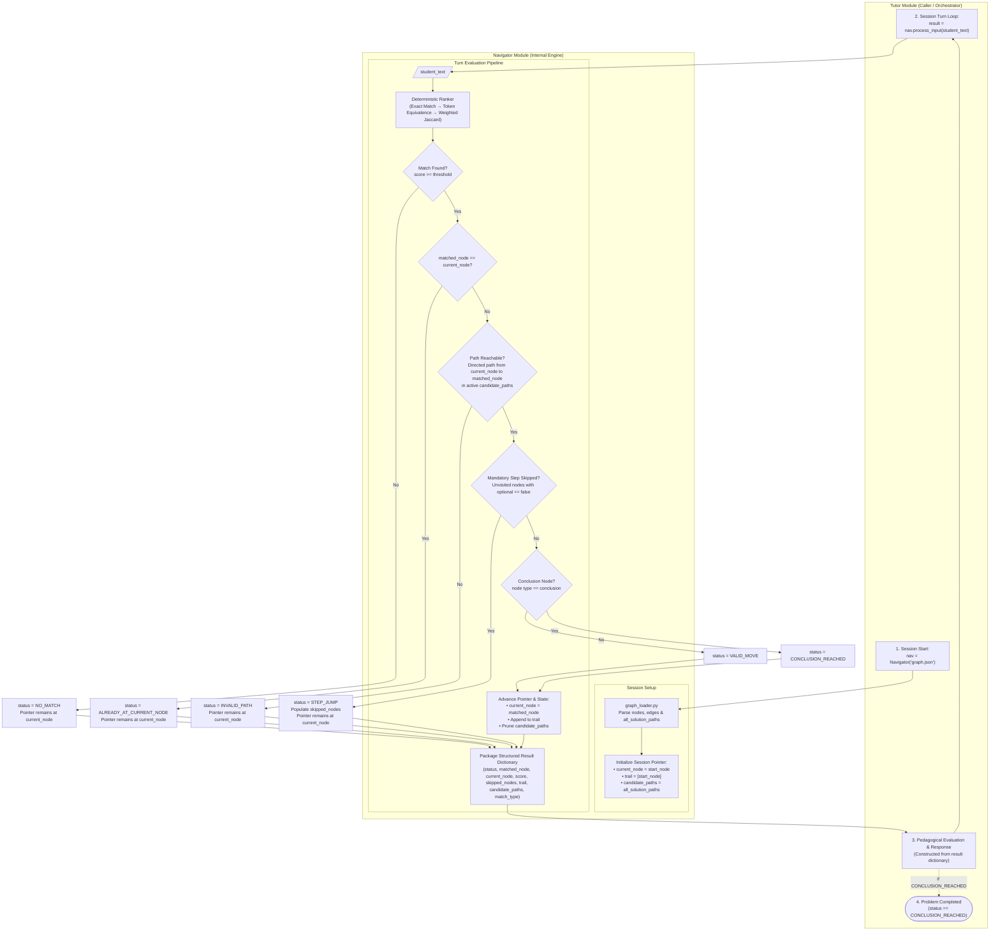

# Navigator — Architecture Document

## Overview

The **Navigator** is an internal backend helper module designed to serve solely the **Tutor**. 
It does not interact with the end-user directly and contains no UI or terminal dependencies.

Its sole purpose is to act as the **roadmap guide ("GPS")** for the Tutor Module across a problem session:

1. **How the Tutor Calls the Navigator**:
   * **Initialization**: At the start of a problem, the **Tutor** module loads the solution graph in the Nagivator: 
     ```python
     nav = Navigator("path/to/graph.json")
     ```

   * **Session Loop**: On each turn, the Tutor passes the student's input string to the Navigator:
     ```python
     result = nav.process_input(student_text)
     ```
     The session ends when the `current_node` points to the conclusion node. 

   * For every student input forwarded by the Tutor Module, the Navigator returns a python
    dictionary `result` back to the Tutor Module, which then decides the appropriate
    pedagogical response. 

2. **Initial State**: 
At session startup, the pointer initializes directly at start node (`current_node = start`, `trail = [start]`, and `candidate_paths = all_solution_paths`).

3. **Core Workflow**: 
On every student input forwarded by the Tutor Module, the Navigator evaluates:
   - **Node Matching**: Uses the deterministic Ranker to find which node in the Solution DAG best matches the student's input.
   
   - **Path Coherence**: Checks whether moving from `current_node` to `matched_node` is reachable along active candidate solution paths.
   
   - **Step-Jump Detection**: Check whether the student skipped over any mandatory intermediate nodes (`optional: false`)?

   - **State Transition:** On a valid move, it advances `current_node`, updates `trail`, filters `candidate_paths`, and build the structured `result` dictionary.

4. **Deterministic Ranker**: 
Node identification is powered by a deterministic, pure-Python scoring pipeline 
(Exact Match Dominance, Token-Set Equivalence, Short-Input Guardrails, Specificity-Weighted Jaccard, and Phrase-Length Tie-Breaking) with zero external dependencies.


5. **Structured Output**: 
The `result` contains the following details:

| Key | Allowed Values / Type | What It Tells the Tutor Module (Comment) |
| --- | --- | --- |
| `"status"` | `str`<br> `"VALID_MOVE"` `"STEP_JUMP"` `"INVALID_PATH"` `"ALREADY_AT_CURRENT_NODE"` `"NO_MATCH"``"CONCLUSION_REACHED"` | Tells the Tutor whether the move is valid forward progression; an illegal leap over mandatory work, an unreachable path, an in-place repetition, off-topic/unmatched input, or the final solution. |
| `"matched_node"` | `dict \| None`<br>Full node dictionary from DAG (or `None` if `NO_MATCH`) | The target node the student's input is trying to address. |
| `"current_node"` | `dict`<br>Full node dictionary from DAG | Where the student is currently standing. |
| `"score"` | `float`<br>`0.0` to `1.0` | The similarity score computed by the Ranker.|
| `"skipped_nodes"` | `list[dict]`<br>List of node dictionaries (empty `[]` unless `"STEP_JUMP"`) | When a student skips mandatory steps (`optional: false`), this list contains the exact missed nodes. |
| `"trail"` | `list[str]`<br>e.g., `["start", "m1_s1", ...]` | Chronological record of all verified node IDs visited by the student across the session. |
| `"candidate_paths"` | `list[list[str]]`<br>List of node ID sequences from `start` to `conclusion` | The remaining possible solution paths. Narrows as the student traverses the graph. |
| `"match_type"` | `str`<br> `"EXACT_STRING_MATCH"` `"JACCARD_SIMILARITY"` | Tells the Tutor which rule in the deterministic Ranker pipeline triggered the match. |
---

## Architectural Design of the Navigator Module 

The diagram below outlines the architectural boundary and interaction loop between the **Tutor Module** (the upstream orchestrator) and the **Navigator Module** (the internal topological engine), as well as the step-by-step turn evaluation pipeline executed by the Navigator:



---

## 1. The Solution DAG Model

Each DAG is a stored `.json` file which is a dictionary. 
The navigator module will primarily need access to the 'nodes' key and 'edges' key 
of the dictionary.  

```json
"nodes": [
    {
      "id": "m1_s1",
      "type": 
      "start/given_extraction/find_extraction/method_selection/step/conclusion",
      "label": "Job description of the node",
      "optional": false, 
      "accept": ["...","...","..."], 
      "hints": ["..."]
    }
  ],
  "edges": [
    { "from": "start", "to": "m1_simplify" },
    { "from": "m1_simplify", "to": "m1_s1" }
  ]
```

**The `optional` field:**
- Value is `false` (mandatory step) or `true` (optional step).
- When `optional: false`, the node **cannot be skipped**; jumping over it triggers a `STEP_JUMP DETECTED` flag.
- When `optional: true`, the student may bypass it without penalty (e.g., extractions, hints).
- Nodes without the key are treated as mandatory (`optional: false`) by default.
- The navigator checks all intermediate nodes along the path equally.

**Solution Paths:**
- A **solution path** is any directed path in the DAG that starts at `start_node` and ends at `conclusion_node`.
- A DAG with multiple methods has multiple such paths (paths can share nodes).
- The navigator enumerates all solution paths at load time.

---

## 4. Session Model

```
Session
├── current_node_id: str | None      # The node the pointer is currently on
├── trail: list[str]                 # Ordered list of node IDs visited so far
├── candidate_paths: list[list[str]] # Solution paths that pass through current_node_id
└── graph: SolutionGraph             # The loaded DAG
```

**Trail:** Grows by appending the new node ID each time the pointer advances.  
**Candidate paths:** Narrowed down each time the pointer moves. Initially all solution paths. 
After each user input and a valid node match, `candidate_paths` contains only those paths that contain the pointing node.

---

## 5. Navigation Workflow (Step by Step)

```
┌─────────────────────────────────────────────────────────────────────────────────┐
│                         Navigator v2 — Full Loop                                │
└─────────────────────────────────────────────────────────────────────────────────┘

                 Load graph.json
                       │
                       ▼
              Print problem statement
              (graph_meta.problem_text)
                       │
              ┌────────┴─────────┐
              │  INTERACTIVE LOOP│◄──────────────────────────────────────────┐
              └────────┬─────────┘                                           │
                       │                                                     │
              Student types input                                            │
                       │                                                     │
                       ▼                                                     │
              ┌─────────────────┐                                            │
              │    RANKER        │  (see §6)                                 │
              │  finds best node │                                           │
              └────────┬────────┘                                            │
                       │                                                     │
              ┌────────┴────────────────────┐                                │
              │ No match found?             │ Yes match found                │
              └────────┬────────────────────┘        │                       │
                       │                             ▼                       │
              Print "No matching node        ┌────────────────┐              │
              found. Try again."             │ FIRST INPUT?   │              │
                       │                    └───┬────────┬────┘              │
                       └─────────────────────► │        │                   │
                                           YES │     NO │                   │
                                               │        │                   │
                                               ▼        ▼                   │
                                     Set      PATH REACHABILITY CHECK        │
                               current_node   (see §7)                      │
                               = matched node      │                        │
                               Narrow candidate    │                        │
                               paths to those ┌────┴──────────────────┐    │
                               containing it  │ No path from current  │    │
                               Print node.    │ node → matched node?  │    │
                               label          └────────────────────────┘   │
                                                   │            │           │
                                             INVALID         VALID PATH     │
                                             PATH            EXISTS         │
                                               │                │           │
                                   Print "INVALID input,       ▼            │
                                   give a valid input."  IMPORTANCE CHECK   │
                                               │          (see §8)          │
                                               │                │           │
                                               │      ┌─────────┴────────┐  │
                                               │      │ Important node   │  │
                                               │      │ in between?      │  │
                                               │      └─────────┬────────┘  │
                                               │           YES  │  NO       │
                                               │            │   │           │
                                               │            ▼   ▼           │
                                               │   Print flag  Move pointer │
                                               │   + skipped   to new node  │
                                               │   node info   Update trail │
                                               │   (do NOT     Print node   │
                                               │   advance)    label        │
                                               │                            │
                                               └────────────────────────────┘
                                                            │
                                                     Loop continues ──────────►
```

---

## 6. The Ranker Pipeline (from v1)

The Ranker takes a **raw student input string** and the **full node list** from the DAG and returns the best-matching node (or `None`). It adopts the deterministic **v1 Ranker Pipeline** without any embedding dependencies or cosine similarity.

### Pipeline Hierarchy

```
Raw Input String
      │
      ▼
  STEP 1: EXACT MATCH DOMINANCE (Rule 1)
  ──────────────────────────────────────────
  - Normalize input and accept strings.
  - Check exact string equality: normalized(input) == normalized(accept_phrase).
  - Check canonical token set equivalence: tokens(input) == tokens(accept_phrase).
  - If exact match found:
      • Collect all exact-matching candidate nodes.
      • Tie-break by highest token count (longest, most specific phrase).
      • Return winner immediately with score 1.0 (short-circuits fuzzy ranking).

      │
      ▼
  STEP 2: FUZZY WEIGHTED JACCARD & INPUT COVERAGE
  ────────────────────────────────────────────────
  For all nodes, compute composite score across all accept phrases:
    - Short-Input Guardrail: Single tokens (len <= 2) require exact containment
      and are scaled by 1/|phrase_tokens| to prevent false matching of complex expressions.
    - Character N-Gram Alignment: Boundary-padded bigram Dice coefficient (cutoff 0.70).
    - Weighted Jaccard: Token-length weighting (|ta| and |tb|) ensures longer,  
      domain-specific tokens outweigh short grammatical particles.
    - Grounded Input Coverage: Fraction of user tokens aligned to the accept phrase.
    - Composite Score: 0.4 * weighted_jaccard + 0.6 * (cov_input * max_alignment).

      │
      ▼
  STEP 3: THRESHOLD GATE
  ───────────────────────
  - If top score <= THRESHOLD (default: 0.50):
      Return None ("BELOW_THRESHOLD" / "No matching node found").

      │
      ▼
  STEP 4: SPECIFICITY TIE-BREAKING (Rule 2)
  ──────────────────────────────────────────
  - If multiple nodes share the top score (within epsilon 1e-9):
      • Select the node whose best-matching accept phrase has the most tokens.
      • Specificity wins over ambiguous short phrases.

      │
      ▼
  STEP 5: RETURN WINNING NODE
  ────────────────────────────
  Return (winner_node, score, match_type, matched_phrase).
```

### Threshold

| Parameter | Default | Notes |
|---|---|---|
| `DEFAULT_THRESHOLD` | `0.50` | Configurable per DAG or session. Strict cutoff prevents false positives. |

---

## 7. Path Reachability Check

After the Ranker returns a matched node `N`, and the session has a `current_node_id` = `C`, the navigator must verify:

> **Is there a directed path in the DAG from `C` to `N`?**

```
Path exists from C to N?
  ├── NO  → INVALID_PATH
  │         Action: Print "INVALID input, give a valid input."
  │         Session: pointer stays at C, trail does NOT change.
  │
  └── YES → Proceed to Importance Check (§8)
```

**Implementation details:**
- Breadth-First Search (BFS) or Depth-First Search (DFS) from `C` following `edges` forward.
- Only edges oriented `from → to` are followed (directed).
- If `N` is not visited during the search → return `INVALID_PATH`.
- **Special case:** `N == C` (user matched the node they are already on).
  - Treated as: `ALREADY_AT_CURRENT_NODE`.
  - Action: Print "You are already at node `C`. Provide a step to move forward." Pointer stays at `C`.

---

## 8. Importance Check & Flagging

When a valid path from `C` to `N` exists, the navigator inspects the **intermediate nodes** along that path.

> **Intermediate nodes** = all nodes on the path strictly between `C` and `N` (excluding `C` and `N`).

```
Does any intermediate node have optional == false (mandatory)?
  │
  ├── YES → STEP JUMP DETECTED
  │         Action:
  │           1. Print:
  │              "STEP JUMP DETECTED. THE FOLLOWING MANDATORY NODE HAS BEEN SKIPPED ->
  │               [node_id] - [node_label]"
  │           2. If multiple mandatory nodes were skipped, list all of them.
  │           3. Print: "Mandatory intermediate node detected."
  │           4. Pointer stays at C.
  │           5. Trail does NOT change.
  │
  └── NO  → ADVANCE
            Action:
              1. Pointer moves: current_node_id = N.
              2. Append N to trail.
              3. Narrow candidate_paths (see §9).
              4. Print: "Advanced to [N.label]".
```

### What if multiple paths exist between `C` and `N`?

In a DAG, multiple distinct paths may connect `C` to `N`:
1. Find all simple directed paths from `C` to `N`.
2. Filter paths to those that are subpaths of currently active `candidate_paths`.
3. If still multiple paths exist, pick the path with the **fewest important intermediate nodes**. If any path has *zero* important intermediates, that path is chosen, and the step jump is **not** triggered.

---

## 9. Candidate Path Narrowing

At session start, all solution paths are active:

$$\text{candidate\_paths} = \text{all\_solution\_paths}$$

When the pointer moves to node `N`:

$$\text{candidate\_paths} = [P \text{ for } P \text{ in candidate\_paths if } N \in P]$$

### Edge Case: Matched node is on a different method branch

If the student switches methods and names a node that is **not** on any current `candidate_path`:
- If reachable from `C`, keep candidate paths that contain both `C` and `N`.
- If no candidate path contains `N`, reachability will fail and return `INVALID_PATH`.

---

## 10. Interactive CLI Specification

### Launch
```bash
python cli.py --dag path/to/graph.json
```

**Commands:**
- Any text → processed as student input.
- `q` or `quit` or `exit` → end session and print traversal summary.
- `trail` → print the nodes visited so far.
- `paths` → inspect remaining candidate solution paths.
- `node` → inspect current node details.
- `hint` → print the hint for the current node (if available).
- `reset` → restart session from beginning.

---

## 11. Module Structure

```
navigator_02/
│
├── ARCHITECTURE.md          ← this file
│
├── graph_loader.py          ← loads graph.json; validates importance field;
│                               enumerates all solution paths (start → conclusion)
│
├── normalizer.py            ← Normalization & math symbol mapping
│
├── scorer.py                ← Deterministic string similarity:
│                               - exact_match()
│                               - token_char_sim() [character bigrams]
│                               - short-input guardrails
│                               - weighted_jaccard() & input coverage
│
├── ranker.py                ← Ranker pipeline (v1 deterministic):
│                               - Pass 1: Exact Match Dominance
│                               - Pass 2: Fuzzy Weighted Jaccard
│                               - Pass 3: Threshold Gate
│                               - Pass 4: Specificity Tie-Breaker
│                               - resolve_with_score(input, nodes)
│
├── path_finder.py           ← Graph traversal utilities:
│                               - all_paths(start, end, graph)
│                               - find_directed_paths(from_id, to_id, dag)
│                               - evaluate_transition(from_id, to_id, dag)
│
├── session.py               ← NavigatorSession class:
│                               - current_node
│                               - visited_nodes
│                               - trail & history
│                               - active_solution_paths narrowing
│
├── navigator.py             ← Core Navigator class:
│                               - __init__(dag_source, threshold)
│                               - process_input(raw_input) → NavigatorResult
│                               NavigatorResult carries:
│                                 status: "FIRST_MATCH" | "ADVANCED" | "STEP_JUMP" |
│                                         "INVALID_PATH" | "ALREADY_AT_CURRENT_NODE" | "NO_MATCH"
│                                 matched_node: dict | None
│                                 current_node: dict | None
│                                 skipped_nodes: list[dict]
│                                 trail: list[str]
│
└── cli.py                   ← Interactive REPL:
                                - arg: --dag <path>
                                - renders result of navigator.process_input()
                                - handles trail/paths/node/hint/reset/quit commands
```

---

## 12. Data Flow Diagram

```
graph.json
    │
    ▼
graph_loader.py
    ├── Node list (with importance)
    ├── Edge list
    ├── start_node, conclusion_node
    └── all_solution_paths  ──────────────────────────────► session.py
                                                               (candidate_paths)
                                                                    │
Student Input ──► ranker.py ──► matched_node ──► navigator.py ◄────┘
                  (Exact Match +                      │
                   Weighted Jaccard              path_finder.py
                   & Specificity)               (reachability +
                                                 importance check)
                                                      │
                                                NavigatorResult
                                                      │
                                                    cli.py
                                               (render to terminal)
```

---

## 13. Key Design Decisions Summary

| Decision | Rationale |
|---|---|
| Deterministic v1 Ranker (Weighted Jaccard + Input Coverage) | High accuracy without heavy vector/embedding dependencies; robust on math syntax and typos |
| Rule 1 Exact Match Dominance | Short-circuits fuzzy ranking when student types exact formula or accept phrase |
| Short-Input Guardrails | Penalizes single-character inputs (e.g. 'x') to prevent false matches on complex equations |
| Specificity Tie-Breaking (Rule 2) | Longer, specific phrase matches outrank short ambiguous keywords |
| Path reachability via directed DAG search | DAGs are acyclic; BFS/DFS is fast and guarantees forward progress along valid paths |
| Fewest important intermediates for path selection | Most permissive path is chosen when multiple routes exist — benefits the student |
| Pointer does NOT advance on step jump | Flagging without advancing forces the student to address the important node |
| Candidate path narrowing | Progressively constrains search space; enables correct multi-path DAG traversal |
| All solution paths enumerated at load time | DAGs are small and static; pre-computation avoids repeated searches at every step |

---

## 14. What Navigator v2 Does NOT Do

- It does **not** evaluate mathematical correctness of the student's answer (that is the Evaluator's job in the backend engine).
- It does **not** manage external database session persistence.
- It does **not** enforce session termination at the conclusion node — the student can keep giving inputs.
- It does **not** perform heavy NLP or semantic embedding models (deterministic string/token math only).

The navigator's sole job is: **given an input string, tell me which node the student is pointing to, and whether that move is valid within the DAG**.
