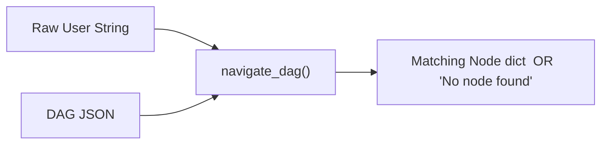
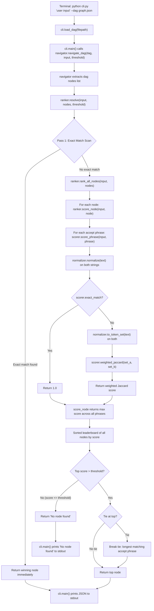
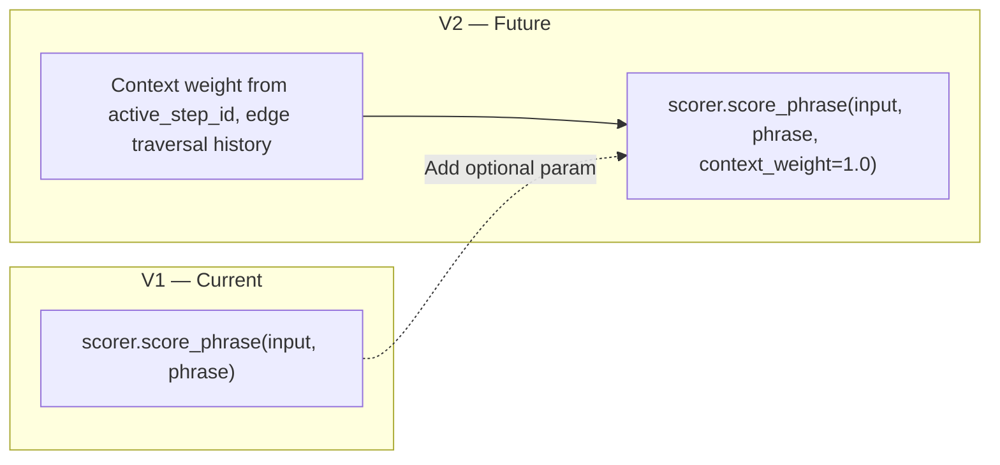
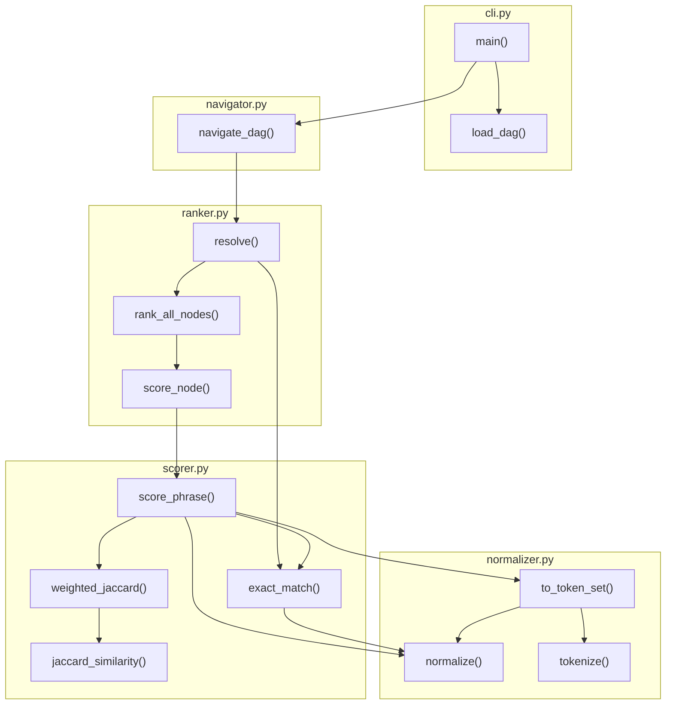

# Navigator Module — Complete Architectural Blueprint

> [!IMPORTANT]
> **This document is a design-only blueprint.** No functional code is included. Every file, function, input, output, and responsibility is specified to serve as a linear construction plan.

---

## 1. Module Overview

The Navigator is a **stateless, pure-function module** that answers one question:

> *"Given a DAG of solution nodes and a raw student string, which single node (if any) does the string belong to?"*

It receives exactly two inputs and produces exactly one output:

| | Type | Description |
|---|---|---|
| **Input 1** | `dict` (parsed from JSON) | The full solution DAG containing `nodes` (each with an `accept` array) and `edges`. |
| **Input 2** | `str` | The raw, unprocessed user input string. |
| **Output** | `dict \| str` | The single best-matching node dictionary, **or** the literal string `"No node found"`. |



---

## 2. File Tree

All files live under a single flat package:

```
backend/app/navigator/
├── __init__.py
├── normalizer.py
├── scorer.py
├── ranker.py
├── navigator.py
└── cli.py
```

**Six files. Zero external dependencies beyond the Python 3.10+ standard library.**

---

## 3. File-by-File Specification

---

### 3.1 `__init__.py`

**Purpose:** Package marker. Re-exports the single public entry point.

| Symbol Exported | Source |
|---|---|
| `navigate_dag` | `navigator.py` |

---

### 3.2 `normalizer.py` — Deterministic Text Normalization Pipeline

**Purpose:** Transform any raw text into a canonical token set suitable for set-arithmetic scoring. Every comparison in the entire module operates on the output of this file—never on raw strings.

#### 3.2.1 Constants

| Name | Type | Description |
|---|---|---|
| `STOPWORDS` | `frozenset[str]` | Immutable set of high-frequency, low-meaning words to strip. Includes: `"a"`, `"an"`, `"the"`, `"is"`, `"to"`, `"what"`, `"find"`, `"we"`, `"are"`, `"do"`, `"need"`, `"does"`, `"of"`, `"it"`, `"that"`, `"this"`, `"how"`, `"which"`, `"can"`, `"will"`, `"be"`, `"was"`, `"has"`, `"have"`, `"been"`, `"our"`, `"us"`, `"i"`, `"my"`, `"me"`, `"you"`, `"your"`, `"so"`, `"then"`, `"try"`, `"trying"`. |
| `SYMBOL_MAP` | `dict[str, str]` | Maps algebraic synonyms to unified tokens. Keys include `"="`, `"equals"`, `"is equal to"`, `"equal to"` → value `"eq"`; `"+"` → `"plus"`; `"-"` → `"minus"`; `"×"`, `"*"`, `"times"` → `"mul"`; `"÷"`, `"/"`, `"divided by"` → `"div"`. |

#### 3.2.2 Functions

---

##### `normalize(text: str) -> str`

| | |
|---|---|
| **Input** | `text`: Any raw string (user input or an accept-array phrase). |
| **Output** | A single lowercase string with symbols standardised, stopwords removed, and whitespace collapsed. |
| **Job** | **(Step 1)** Lowercase + strip leading/trailing whitespace. **(Step 2)** Replace multi-character symbol phrases first (e.g., `"is equal to"` → `"eq"`), then single-character symbols from `SYMBOL_MAP`. **(Step 3)** Strip all remaining non-alphanumeric, non-space punctuation (apostrophes, commas, periods, etc.) except the unified tokens inserted in Step 2. **(Step 4)** Collapse whitespace to single spaces. The output is a clean, flat string. |
| **Example** | `"We are trying to find the daughter's present age"` → `"trying daughter present age"` → (after stopword removal in `tokenize`) usable downstream. |

> [!NOTE]
> `normalize` does **not** remove stopwords itself. It standardises the surface form. Stopword removal happens in `tokenize`, so that `normalize` output can be used independently for exact-match checks *before* tokenization.

---

##### `tokenize(text: str) -> list[str]`

| | |
|---|---|
| **Input** | `text`: A **pre-normalized** string (output of `normalize`). |
| **Output** | A `list[str]` of content-bearing tokens, with every stopword removed. |
| **Job** | Split the normalized string on whitespace. Filter out every token found in `STOPWORDS`. Return the remaining tokens as an ordered list. |
| **Example** | `"trying daughter present age"` → `["daughter", "present", "age"]` (since `"trying"` is a stopword). |

---

##### `to_token_set(text: str) -> frozenset[str]`

| | |
|---|---|
| **Input** | `text`: Any **raw** string (not yet normalized). |
| **Output** | A `frozenset[str]` of canonical, content-bearing tokens. |
| **Job** | Convenience wrapper. Calls `normalize(text)`, then `tokenize(result)`, then wraps in `frozenset`. This is the single function the rest of the module calls to get the canonical token representation of any string. |
| **Example** | `"Find the daughter's present age"` → `frozenset({"daughter", "present", "age"})`. |

---

### 3.3 `scorer.py` — Scoring Metric Engine

**Purpose:** Compute a scalar similarity value in `[0.0, 1.0]` between two token sets. This file contains **only** pure mathematical functions and knows nothing about DAGs, nodes, or the domain.

#### 3.3.1 Functions

---

##### `jaccard_similarity(set_a: frozenset[str], set_b: frozenset[str]) -> float`

| | |
|---|---|
| **Input** | Two frozen sets of tokens. |
| **Output** | A `float` in `[0.0, 1.0]`. |
| **Job** | Compute: $J(A, B) = \dfrac{\|A \cap B\|}{\|A \cup B\|}$. Returns `0.0` if the union is empty (both sets are empty). |

---

##### `weighted_jaccard(set_a: frozenset[str], set_b: frozenset[str]) -> float`

| | |
|---|---|
| **Input** | Two frozen sets of tokens. |
| **Output** | A `float` in `[0.0, 1.0]`. |
| **Job** | Applies a **token-length weight**: tokens with more characters contribute more to both intersection and union sums. Specifically, for each token `t`, its weight is `len(t)`. The score is: $$WJ(A, B) = \dfrac{\sum_{t \in A \cap B} w(t)}{\sum_{t \in A \cup B} w(t)}.$$ Here longer tokens like `"daughter"` carry more weight than short tokens like `"age"`. Returns `0.0` if the weighted union is zero. |

---

##### `exact_match(normalized_input: str, normalized_phrase: str) -> bool`

| | |
|---|---|
| **Input** | Two **normalized** (but not tokenized) strings. |
| **Output** | `bool`. |
| **Job** | String equality after normalization: `normalized_input == normalized_phrase`. This implements **Exact Match Dominance**. This short-circuits the entire scoring process. |

---

##### `score_phrase(input_text: str, accept_phrase: str) -> float`

| | |
|---|---|
| **Input** | `input_text`: the raw user string. `accept_phrase`: one raw element from a node's `accept` array. |
| **Output** | A `float` in `[0.0, 1.0]`. `1.0` indicates a perfect/exact match. |
| **Job** | The **composite scoring function** for a single `(input, phrase)` pair. Execution order: **(1)** Normalize both strings via `normalizer.normalize()`. **(2)** If `exact_match` returns `True`, immediately return `1.0` (Rule 1: Exact Match Dominance). **(3)** Otherwise, compute `to_token_set` for both, then return `weighted_jaccard(set_a, set_b)`. |

> **V2 Extensibility Hook:** `score_phrase` accepts only `input_text` and `accept_phrase` today. In V2, an optional third parameter `context_weight: float = 1.0` can be injected to bias the score based on graph-traversal context, without changing the base algorithm.

---

### 3.4 `ranker.py` — Scoring Hierarchy & Collision Resolution

**Purpose:** Score the user input against *every* node in the DAG and apply the hierarchy rules and threshold guardrails to pick a single winner. This is the **brain** of the module—it orchestrates the scorer across the full node list and resolves ties.

#### 3.4.1 Constants

| Name | Type | Description |
|---|---|---|
| `DEFAULT_THRESHOLD` | `float` | Default minimum similarity score. Set to `0.5`. If the highest-scoring node falls below this, the navigator returns `"No node found"`. |

#### 3.4.2 Functions

---

##### `score_node(input_text: str, node: dict) -> float`

| | |
|---|---|
| **Input** | `input_text`: the raw user string. `node`: a single node dictionary from the DAG (must contain an `"accept"` key with a list of strings). |
| **Output** | A `float` — the **best score** this node achieves against the input. |
| **Job** | Iterate over every phrase in `node["accept"]`. For each phrase, call `scorer.score_phrase(input_text, phrase)`. Return the **maximum** score across all phrases. If `node["accept"]` is empty or missing, return `0.0`. This represents the node's best possible affinity to the user input. |

---

##### `rank_all_nodes(input_text: str, nodes: list[dict]) -> list[tuple[dict, float]]`

| | |
|---|---|
| **Input** | `input_text`: the raw user string. `nodes`: the full list of node dictionaries from the DAG. |
| **Output** | A `list[tuple[dict, float]]` — every node paired with its best score, sorted descending by score. |
| **Job** | For each node in `nodes`, call `score_node(input_text, node)`. Collect all `(node, score)` pairs. Sort by score descending (highest first). Return the sorted list. This is the raw ranked leaderboard before any hierarchy rules or thresholds are applied. |

---

##### `resolve(input_text: str, nodes: list[dict], threshold: float) -> dict | str`

| | |
|---|---|
| **Input** | `input_text`: the raw user string. `nodes`: the full list of node dictionaries. `threshold`: the minimum score cutoff. |
| **Output** | The winning node `dict`, or the string `"No node found"`. |
| **Job** | The **complete collision resolution pipeline**. Steps: |

**Resolution Algorithm (step by step):**

1. **Exact-match scan (Rule 1).** Before any fuzzy scoring, iterate over all nodes. For each node, normalize the user input and each accept phrase. If any `exact_match` returns `True`, immediately return that node. If multiple nodes have exact matches, prefer the one whose matching accept phrase is **longest** (most specific). This guarantees that an exact post-normalization match always wins, regardless of fuzzy scores elsewhere.

2. **Fuzzy ranking.** Call `rank_all_nodes(input_text, nodes)` to get the full scored leaderboard.

3. **Threshold gate.** If the top-ranked node's score is **less than or equal to** `threshold`, return `"No node found"`. The threshold is a strict lower bound — the score must *exceed* it to qualify.

4. **Tie-breaking (Rule 2: Specificity Weighting).** If the top two (or more) nodes share the same score (within a floating-point epsilon of `1e-9`), break the tie by selecting the node whose **best-matching accept phrase has the most tokens** after normalization/tokenization. A longer matching phrase is more specific and therefore more trustworthy.

5. **Return the winner.** Return the full node dictionary of the winning node.

> [!IMPORTANT]
> **Collision Resolution Strategy:** The two-pass design (exact scan → fuzzy rank) ensures that a student typing `"daughter's present age"` exactly matching an accept phrase always beats a different node that happens to share the tokens `"age"` and `"present"`. Specificity weighting in the Jaccard metric further penalises short, ambiguous overlaps. The tie-breaker by longest matching phrase is the final disambiguation layer.

---

### 3.5 `navigator.py` — Public Entry Point (Pure Function)

**Purpose:** The single public function that external code calls. It handles DAG parsing, delegates to the ranker, and returns the result. This is the **only file imported by consumers**.

#### 3.5.1 Functions

---

##### `navigate_dag(dag: dict, user_input: str, threshold: float = 0.5) -> dict | str`

| | |
|---|---|
| **Input** | `dag`: A Python dictionary representing the parsed DAG JSON. Must contain a `"nodes"` key. `user_input`: The raw student string. `threshold`: Minimum score cutoff (default `0.5`). |
| **Output** | The best-matching node `dict`, or `"No node found"`. |
| **Job** | **(1)** Extract the `nodes` list from `dag["nodes"]`. **(2)** Validate that every node in the list has an `"accept"` key (treat missing as empty list). **(3)** Call `ranker.resolve(user_input, nodes, threshold)`. **(4)** Return whatever `resolve` returns. |

> [!NOTE]
> **Statelessness guarantee:** `navigate_dag` reads nothing from any external state—no session, no database, no file system beyond the inputs it is handed. It is a pure function: same inputs → same output, every time.

---

### 3.6 `cli.py` — Terminal Interface

**Purpose:** A runnable command-line script that lets a user invoke the navigator directly from a terminal shell. Pass a user string and a path to a DAG JSON file, get the matched node printed to stdout.

#### 3.6.1 Functions

---

##### `load_dag(filepath: str) -> dict`

| | |
|---|---|
| **Input** | `filepath`: Path to a JSON file on disk. |
| **Output** | A Python `dict` — the parsed DAG. |
| **Job** | Open the file, parse it with `json.load()`, return the dictionary. Raises `FileNotFoundError` or `json.JSONDecodeError` on failure with a clear error message to stderr. |

---

##### `main() -> None`

| | |
|---|---|
| **Input** | None (reads from `sys.argv` via `argparse`). |
| **Output** | None (prints to stdout). |
| **Job** | **(1)** Define an `argparse.ArgumentParser` with three arguments: |

| Argument | Flag | Required | Default | Description |
|---|---|---|---|---|
| `input` | positional | Yes | — | The raw user input string (quoted). |
| `dag` | `--dag` | Yes | — | Path to the DAG JSON file. |
| `threshold` | `--threshold` | No | `0.5` | Minimum similarity threshold. |

**(2)** Parse args. **(3)** Call `load_dag(args.dag)` to get the DAG dict. **(4)** Call `navigate_dag(dag, args.input, args.threshold)`. **(5)** If the result is a `dict`, pretty-print it as formatted JSON to stdout via `json.dumps(result, indent=2)`. If the result is the string `"No node found"`, print that string to stdout. **(6)** Exit with code `0` on success, `1` on any error.

#### 3.6.2 Usage Examples

```bash
# Basic usage
python -m backend.app.navigator.cli "daughter's present age" --dag solution_graph/chapter-7/.../graph.json

# With custom threshold
python -m backend.app.navigator.cli "find the HCF" --dag graph.json --threshold 0.6

# Input that matches no node
python -m backend.app.navigator.cli "hello world" --dag graph.json
# Output: No node found
```

#### 3.6.3 `if __name__ == "__main__"` Guard

The file ends with the standard guard block so it can be executed directly:

```
if __name__ == "__main__":
    main()
```

---

## 4. Complete Data-Flow Pipeline

This diagram shows the exact execution path when `cli.py` is invoked:



---

## 5. Scoring Formula Summary

For a single `(user_input, accept_phrase)` pair, the score is computed as:

$$
\text{score}(I, P) =
\begin{cases}
1.0 & \text{if } \text{normalize}(I) = \text{normalize}(P) \\[6pt]
\dfrac{\displaystyle\sum_{t \,\in\, A \cap B} \text{len}(t)}{\displaystyle\sum_{t \,\in\, A \cup B} \text{len}(t)} & \text{otherwise}
\end{cases}
$$

where $A = \text{to\_token\_set}(I)$ and $B = \text{to\_token\_set}(P)$.

For a single **node**, its score is:

$$\text{node\_score}(I, N) = \max_{p \,\in\, N.\text{accept}} \; \text{score}(I, p)$$

---

## 6. Hierarchy Rules Applied

| Priority | Rule | Mechanism | Location |
|---|---|---|---|
| **1** | Exact Match Dominance | Normalized string equality → instant `1.0`, bypasses fuzzy | `scorer.exact_match` → `scorer.score_phrase` and `ranker.resolve` Pass 1 |
| **2** | Specificity Weighting | Token-length-weighted Jaccard penalises short/ambiguous overlaps | `scorer.weighted_jaccard` |
| **3** | Threshold Guardrail | Score ≤ threshold → `"No node found"` | `ranker.resolve` Step 3 |
| **4** | Tie-breaker | Longest matching accept phrase (token count) wins ties | `ranker.resolve` Step 4 |

---

## 7. V2 Extensibility Surface

The architecture isolates scoring from navigation:



- `score_phrase` gains an optional `context_weight` parameter.
- `ranker.resolve` gains an optional `context: dict` parameter containing active step ID and traversal history.
- **No refactoring of `normalizer.py`, `scorer.jaccard_similarity`, or `scorer.weighted_jaccard` is needed.** The base algorithms remain untouched.

---

## 8. Function Dependency Graph



---

## 9. Complete Function Index

| # | File | Function | Inputs | Output | One-Line Job |
|---|---|---|---|---|---|
| 1 | `normalizer.py` | `normalize(text)` | `str` | `str` | Lowercase, symbol-standardise, strip punctuation, collapse whitespace. |
| 2 | `normalizer.py` | `tokenize(text)` | `str` (normalized) | `list[str]` | Split on whitespace, remove stopwords. |
| 3 | `normalizer.py` | `to_token_set(text)` | `str` (raw) | `frozenset[str]` | Full pipeline: normalize → tokenize → frozenset. |
| 4 | `scorer.py` | `jaccard_similarity(a, b)` | two `frozenset[str]` | `float` | Standard Jaccard: \|A∩B\| / \|A∪B\|. |
| 5 | `scorer.py` | `weighted_jaccard(a, b)` | two `frozenset[str]` | `float` | Length-weighted Jaccard for specificity. |
| 6 | `scorer.py` | `exact_match(a, b)` | two `str` (normalized) | `bool` | String equality check. |
| 7 | `scorer.py` | `score_phrase(input, phrase)` | two `str` (raw) | `float` | Composite: exact match → 1.0, else weighted Jaccard. |
| 8 | `ranker.py` | `score_node(input, node)` | `str`, `dict` | `float` | Max score across all accept phrases. |
| 9 | `ranker.py` | `rank_all_nodes(input, nodes)` | `str`, `list[dict]` | `list[tuple]` | Score every node, sort descending. |
| 10 | `ranker.py` | `resolve(input, nodes, threshold)` | `str`, `list[dict]`, `float` | `dict \| str` | Full resolution: exact scan → rank → threshold → tie-break. |
| 11 | `navigator.py` | `navigate_dag(dag, input, threshold)` | `dict`, `str`, `float` | `dict \| str` | Public entry: extract nodes, delegate to resolve. |
| 12 | `cli.py` | `load_dag(filepath)` | `str` | `dict` | Read and parse a JSON file. |
| 13 | `cli.py` | `main()` | `sys.argv` | stdout | Parse args, run navigator, print result. |

