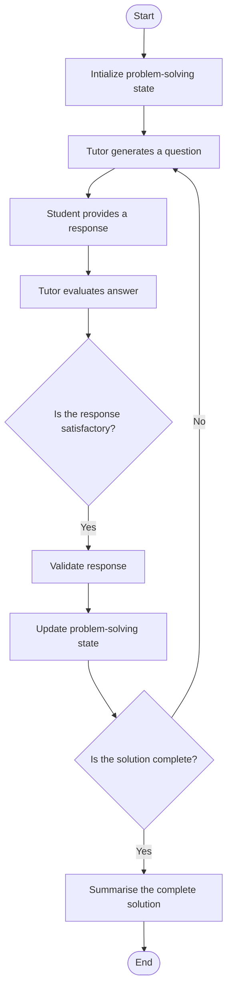

# Socratic Tutoring Algorithm 

## Core Components of an AI Socratic Tutor

The four main component of the tutoring algorithm are: 

| Component | Purpose |
|---|---|
| Problem Solving State | Tracks what has been established and what remains to be solved. |
| Student response | Captures the student's answer and explanation. |
| Evaluation | Classifies the response as correct, partially correct, incorrect, or unclear. |
| Next action | Determines whether to validate, probe, hint, clarify, or move forward. |

### Response Categories

### Probing 

Probing := asking targeted follow-up questions to uncover and develop the student's reasoning.

Some common probing questions:
- Why do you think so?
- Can you explain your reasoning?
- What makes you choose this approach?
- Can you give an example?
- What happens if we change this condition?

## Tutoring Flowchart 

